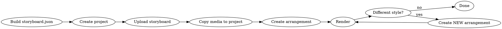

# Cuco Video Engine

## The user mentions a video of theirs? It's a project in the app

"My new cucostudio video", "my video *How To Make A Style*", "the latest one": these
are **projects in the CucoStudio app**. Their script is the storyboard (one text per
section). Do NOT search the filesystem, Spotlight, writing apps or edit folders for it.
Edit folders only hold raw footage and recordings.

```bash
scripts/find_project.py                          # 10 most recently edited projects
scripts/find_project.py "motion designers"       # name match (all words), newest first
scripts/find_project.py "motion designers" --script   # + numbered section texts
scripts/find_project.py --latest --script        # "my new video" with no name given
```

- **Several matches?** Users keep variants (e.g. `…-written` and `…-recorded`). List
  them and say which one you read, or ask if it matters for the task.
- **Section numbers are the shared vocabulary.** Refer to `[n]` when reviewing, so the
  user can find the line in the app.
- **Check how sections are voiced before proposing text edits.** With `origin: "text"`,
  the text IS the narration (TTS), so edits change what is said. With `origin: "audio"`
  (story clip), the text is aligned to a recorded voice; editing it changes the captions
  but not the voice, so flag fixes that would make captions disagree with the recording.
- Proofreading or reviewing only needs a read. Apply changes to the app only when asked,
  and then follow the fetch-fresh sequence below.

## ⚠️ Editing an existing story? Fetch it fresh FIRST

`cuco storyboard update` **replaces the entire storyboard** — anything not in your
file is destroyed. The user edits stories in the app between your edits; a stale
copy silently reverts their work on every upload.

Non-negotiable sequence for every edit of an existing project:

```bash
# 1. ALWAYS pull the current storyboard immediately before building the edit
cuco --json storyboard get <PROJECT_ID> > current.json

# 2. Apply ONLY the intended delta to current.json — never rebuild from a
#    scratch file saved earlier in the session or from your previous upload

# 3. If you uploaded before, diff current.json against your last upload to
#    surface user edits — anything that differs is THEIRS, keep it

# 4. Upload
cuco storyboard update <PROJECT_ID> --file edited.json
```

The app's copy is the only source of truth. Your scratch files are never authoritative.

## ⚠️ Read the style before designing anything for it

A CucoStudio style is the **brand's style guide**, made by the designer. Any media you
generate, source or grade for a video (renders, diagrams, title art, color choices, fonts in
annotations, even the narration voice) must be derived from the style you are going to render
with. Don't invent an aesthetic and hope it fits. Before designing:

```bash
python3 ${CLAUDE_SKILL_DIR}/scripts/style_brief.py <STYLE_ID> --out style_brief
```

Then **look at** `style_brief/poster_sheet.jpg` (Read the image) and, when media placement
matters, run `scripts/probe_style.sh <STYLE_ID>` and look at that frame too. Take from it:

- **Canvas for your media** = the style's media slot, from `manifest.json` `shot_list` entries that
  have a `frame` (e.g. Cuco: a 1155×777 card; others: 1080×1080, 600×840, a 1750×500 banner,
  full-bleed 1440×1080). Sections with media are placed into these shots; generate at that
  aspect or it gets cropped.
- **Palette roles**: which palette color is the background, the ink, the accent. The palette is
  unordered, so decide from the poster. A placeholder palette (e.g. all `#ff0000`) means the
  colors live only in the poster.
- **Typefaces**: `fonts` are PostScript names; the files are usually installed locally
  (`style_brief.py` resolves them). Use the real brand font in any text you draw.
- **What the style already draws**: captions (word-by-word, where?), frames/borders, HUD bars,
  logos, texture. Don't duplicate it and don't put your own text where it lands.
- **Text capacity**: text shots have `chars` (max characters shown at once). Short sections read better.
- **Generated media (Comfy H3/Krea/LTX) must look like it was shot for this style.** Write one LOOK
  sentence from the poster (palette as light and color, texture, mood) plus the caption-safe zone
  ("the bottom quarter of the frame is calm and uncluttered: …") and paste them verbatim into every
  prompt, so every shot shares the same world. Generators mostly ignore grading words, so finish every clip
  with `scripts/style_grade.py <STYLE_ID> in.mp4 out.mp4`, which gradient-maps it onto the palette.
  Check it against the poster by sampling pixels, then tile one frame per shot and confirm the set
  reads as one world before rendering.
- **Voice**: `voice_sample.wav` in the template folder or `voice_id` in the style metadata means the
  brand has a voice. Prefer it for narration; ask the user before cloning a sample, then
  `scripts/brand_voice.py clone <STYLE_ID>` (and `check` a line for intelligibility).

## Generated animation media (no footage? build it)

For explainers ("teach me how a house is framed", "show how X works"), generate the visuals
with a graphics engine instead of searching for media: a procedural three.js model, built
piece-by-piece in sync with the narration, annotated like a textbook plate, one clip per
section. **Every section boundary is a cut**: design each clip's opening shot to be clearly different
from the previous clip's closing shot (shot size ≥ 2 steps, angle ≥ 30°, or a different subject),
otherwise the near-identical frames read as a jarring jump cut. Check with
`node render.mjs --seams` before rendering. **Read `${CLAUDE_SKILL_DIR}/references/generated-animation.md` first** (`$CUCO_SKILL` there = `${CLAUDE_SKILL_DIR}`); it has the full pipeline, the
review loop, and what went wrong the first time. A working engine lives in
`templates/threejs-explainer/` (copy it, replace `scene.js` + `beats.js`). Helper scripts:

| script | does |
|---|---|
| `scripts/find_project.py [name\|id] [--latest] [--script]` | find a project by name or recency; `--script` prints its numbered section texts |
| `scripts/style_grade.py <STYLE_ID> in out [--mix --floor]` | grade generated media into the style palette (gradient map + bloom + grain + caption floor) |
| `scripts/style_brief.py <STYLE_ID> [--apply DIR]` | style → design brief (palette, fonts→files, media slots, text shots, poster sheet, voice); `--apply` writes the template's `theme.json` + copies brand fonts |
| `scripts/probe_style.sh <STYLE_ID>` | renders a test pattern through a style → where the media slot and captions are, and what gets cropped |
| `scripts/narrate_story_clip.py beats.json --project N` | ElevenLabs voice per section → one story clip + `durations.json` (drives clip lengths) |
| `scripts/attach_clips.py beats.json --project N --clips clips --clip-id UUID` | fetch storyboard fresh, attach 1 clip per section, bind the story clip, upload |
| `scripts/brand_voice.py clone <STYLE_ID>` / `check file.mp3 "text"` | clone the style's voice sample in ElevenLabs; verify a line via speech-to-text |
| `scripts/cut_frames.py <PID> <AID>` | frames just before/after every cut in the final video (jump-cut + transition check) |
| `scripts/check_audio.sh video.mp4` | fails if the render is silent |

## Core Concepts

**Storyboard** = sections with text + media. This is your video content.

**Arrangement** = storyboard + style → rendered output. Each arrangement is a VERSION.

**Style** = visual template (fonts, layout, motion). Different style = different arrangement.

## Workflow



## Build the Storyboard

Get the structure, then fill it:

```bash
cuco storyboard scaffold --sections=3 > storyboard.json
```

Edit `storyboard.json` with your content:

```json
{
  "sections": [
    {
      "text": "Your narration for section one.",
      "media": [{"filePath": "projects/1/attached_media/image1.jpg", "fileHash": "abc123...", "originalName": "image1.jpg", "fileSize": 12345, "mimeType": "image/jpeg"}],
      "origin": "text",
      "story_source": "text",
      "language": "en",
      "mute": false
    }
  ],
  "soundtrack_duration": 0
}
```

## Commands

```bash
# 1. Create project
cuco project create --name "My Video"
# → ok id=1

# 2. Copy media into project folder
PROJ=~/Library/Application\ Support/CucoStudio/projects/1
mkdir -p "$PROJ/attached_media"
cp image.jpg "$PROJ/attached_media/"
shasum -a 256 "$PROJ/attached_media/image.jpg"  # get hash for storyboard.json

# 3. Build storyboard.json with media references (see above)

# 4. Upload complete storyboard
cuco storyboard update 1 --file storyboard.json

# List styles
cuco --json style list

# Create arrangement with style
cuco arrangement create 1 --patch-json '{"style_id": 7}'
# → ok id=42

# Render
cuco arrangement process 1 42 --render --style-id=7 --wait
# → ok status=COMPLETED

# Output at:
# ~/Library/Application Support/CucoStudio/projects/1/arrangements/42/video.mp4
```

**`--wait` times out at 600s (exit 2, `FAIL timeout=600`) but the render job keeps
running.** For long videos, poll status via the CLI until it leaves PROCESSING:

```bash
cuco --json arrangement list <PROJECT_ID>   # find your arrangement's "status"
```

Poll through the CLI only — never query the app's sqlite database directly; the
running backend owns it.

## Gotchas

- **Text-section TTS can be silently empty.** Sections with `origin: text` + `mute: false` are
  voiced by the local Chatterbox TTS; it has produced −91 dB WAVs with `synthetic_timing: true`
  while health checks said ok, and the render then had no voice. Run
  `scripts/check_audio.sh` on every render. For narration that matters, supply your own voice-over
  as a story clip (`scripts/narrate_story_clip.py`).
- **Media clips keep their own audio in the render** (mixed under the story track), so generated
  ambience/SFX (H3) plays as-is; strip it with `-an` only if it fights the voice.
- **Muted text sections ignore media length** (~2 s for a short line). For timed shots, drive timing with a
  story clip. `narrate_story_clip.py` takes per-beat `"voice"` (narrator + characters), `"gap"` (hold
  a pause for a comic beat) and `"say"` (speak something other than the caption).
- **Story clip wiring:** put the file at `projects/<PID>/story_clips/<uuid>.<ext>` and set every
  section to `origin: "audio"`, `story_source: "upload"`, `clip_id: "<uuid>"`. One clip can back
  all sections; Cuco aligns each section's text inside it.
- **Section timing** after processing is in `arrangements/<AID>/screenplay.json`
  (`sections[i].section_in / duration`). `process --no-render` gets it without rendering.
- **`cuco files copy-local` refuses sources outside allowed dirs** (e.g. `/private/tmp`
  scratchpads) with 403 ACCESS_DENIED. Copy into `attached_media/<sha256>.<ext>` by hand.
- **Styles frame media differently.** Some show it in a card or crop, not full frame. Read the
  media slots (`style_brief.py`) before generating media and match their aspect. After
  `process`, `screenplay.json` → `sections[i].shot.frame` shows the slot each section got.

## Multiple Styles

Want the same video in different styles? Create multiple arrangements:

```bash
# Style A
cuco arrangement create 1 --patch-json '{"style_id": 2}'
# → ok id=42
cuco arrangement process 1 42 --render --style-id=2 --wait

# Style B
cuco arrangement create 1 --patch-json '{"style_id": 7}'
# → ok id=43
cuco arrangement process 1 43 --render --style-id=7 --wait
```

Each arrangement = one version. Never re-render the same arrangement with a different style.

## Media Structure

```json
{
  "filePath": "projects/{PROJECT_ID}/attached_media/filename.jpg",
  "fileHash": "sha256-hash-of-file",
  "originalName": "filename.jpg",
  "fileSize": 12345,
  "mimeType": "image/jpeg"
}
```

Get hash: `shasum -a 256 path/to/file.jpg | cut -d' ' -f1`

Two levers for a faster-paced edit:

- **Split sections** — tight grip: each smaller section binds its text to exactly
  the media you chose, so you control what shows where.
- **Stack media in one section** — `media` is an array; multiple entries cut
  within the section's duration, but the engine decides the distribution, so
  placement is more stochastic.

Splitting is precision, stacking is speed-per-effort. Pick per moment: split for
lines where a specific image must land on a specific word; stack where any of the
images works across the line.

## Output

```
~/Library/Application Support/CucoStudio/projects/{PROJECT_ID}/arrangements/{ARR_ID}/
├── video.mp4          # Final video
├── thumbnail.png      # Thumbnail
└── screenplay.json    # Generated screenplay
```
